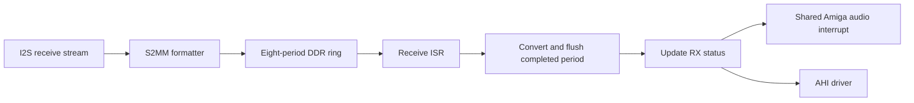

# ZZ9000AX AHI recording protocol

ZZ9000AX firmware records the I2S receive stream into an eight-period DDR
ring. With recording enabled, it converts each completed 48 kHz S16LE stereo
period to the frame count selected through `REG_ZZ_AUDIO_SCALE`, writes S16BE
stereo frames back to that period, and reports the result through
`REG_ZZ_AUDIO_RX_STATUS`.

Playback and recording use the shared Amiga audio interrupt. The playback
completion status at `REG_ZZ_AUDIO_TX_STATUS` identifies the ring period that
is safe to refill. Recording remains available if the SDK audio fabric owns
playback; in that case firmware clears the requested playback bit and retains
the recording bit.

## How a capture period is published

The receive formatter writes 960 input frames, or 3840 bytes, to each ring
period. The ISR derives the newest completed period from the DMA transfer
count. If interrupt service was delayed, it publishes up to seven completed
periods. The eighth slot is the formatter's active write target and is never
published as backlog.

For every published period, firmware performs these steps:

1. Invalidates the completed DMA range from the CPU cache.
2. Converts the period to the selected output frame count.
3. Flushes `frame_count * 4` bytes and issues a data-synchronization barrier.
4. Updates the packed receive status with that period and the next sequence.
5. Raises the shared Amiga audio interrupt after processing the batch.

The receive-status update is the publication boundary. A driver must wait for
a changed sequence before reading a period. Sequences use 12 bits and wrap
modulo 4096.

## Registers

`REG_ZZ_AUDIO_CONFIG` is at `0xF4`. Its read and write meanings differ.

| Access | Bits | Meaning |
| --- | --- | --- |
| Read | 0 | Codec present. |
| Read | 1 | Packed transmit-period status available at `0xF8`. |
| Write | 0 | Enable playback-period interrupts. |
| Write | 1 | Enable capture-ready interrupts. |

Writes are masked to bits 0 and 1. Existing playback software that writes
only zero or one therefore retains the same control values.

`REG_ZZ_AUDIO_RX_STATUS` at `0xF6` is read-only.

| Bits | Meaning |
| --- | --- |
| 15 | Capture protocol available. |
| 14:12 | Newest completed receive-period index, 0 through 7. |
| 11:0 | Completion sequence, modulo 4096. |

`REG_ZZ_AUDIO_TX_STATUS` at `0xF8` is read-only.

| Bits | Meaning |
| --- | --- |
| 15 | Packed transmit-period status available. |
| 14:12 | Most recently completed transmit-period index, 0 through 7. |
| 11:0 | Completion sequence, modulo 4096. |

Firmware updates transmit status on every MM2S completion, before it raises a
playback interrupt. A driver samples the sequence when playback starts and
refills the reported completed period only after the sequence changes. This
avoids assuming that the continuously running formatter starts at ring offset
zero.

A driver should interpret packed transmit status only when both the read bit 1
at `0xF4` and bit 15 at `0xF8` are set. The receive protocol is indicated by
bit 15 at `0xF6`.

## Conversion rules and limits

`REG_ZZ_AUDIO_SCALE` at `0x74` selects the capture output frame count. The
input is always 960 frames at 48 kHz. Each frame is stereo S16LE on input and
stereo S16BE after conversion.

| Output frames | Output rate |
| ---: | ---: |
| 160 | 8 kHz |
| 240 | 12 kHz |
| 480 | 24 kHz |
| 640 | 32 kHz |
| 882 | 44.1 kHz |
| 960 | 48 kHz |

The converter preserves filter state between periods. A change to the selected
frame count, recording start, or receive-ring reassignment resets that state.
Repeated writes of the same frame count do not reset it.

Values of zero or above 960 are clamped to 960 frames. Other values from 1
through 959 use the 960-frame path, which changes sample byte order without
resampling.

## Receive-ring retargeting

The driver selects an RX ring through `AP_RX_BUF_OFFS_HI` and
`AP_RX_BUF_OFFS_LO` using `REG_ZZ_AUDIO_PARAM` and `REG_ZZ_AUDIO_VAL`. Write
the high offset first and the low offset second. The low-offset write sets the
new CPU-side pointer and schedules I2S and audio-formatter reinitialization in
the main loop.

Firmware clears capture readiness before it exposes the pending ring pointer.
Receive interrupts during that interval are acknowledged without conversion,
sequence advancement, or an Amiga audio interrupt. After formatter restart,
firmware enables capture readiness and begins publishing completed periods to
the new ring. The receive sequence is retained across reassignment.

The ring stride is 3840 bytes at every output rate. Only the converted byte
count changes.

## Compatibility history

| Earlier interface | Current handling |
| --- | --- |
| Playback used `REG_ZZ_AUDIO_CONFIG` as a zero-or-one control value. | Those values remain valid write masks. |
| Playback used a sequential refill cursor. | Drivers can use the capability-gated packed status at `0xF8` to refill the completed period. |
