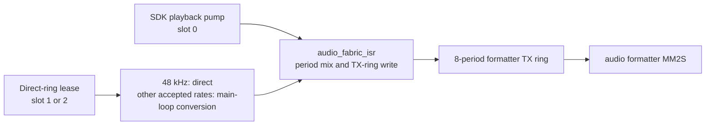

# Audio fabric

The audio fabric mixes SDK playback and direct-ring audio sources into the
formatter TX ring. Firmware advertises it through `SDK_CAP_AUDIO_FABRIC`,
`SDK_SERVICE_FLAG_AUDIO_FABRIC`, and `SDK_SERVICE_FLAG_AUDIO_FABRIC_RATE`.
The fabric owns the output while a producer is active, so register-driven
legacy playback cannot retarget the formatter during a mixed session.

The formatter runs at 48 kHz. Each 20 ms period is 3,840 bytes of stereo
S16 PCM, or 960 frames. The TX ring has eight periods. The FPGA audio
formatter exposes the MM2S stream interface that reads this ring.

## Audio path



`audio_fabric_isr()` runs from the audio formatter period interrupt. It fills
a bounded period for each live slot, accumulates samples in `int32_t`, clamps
the mix once to S16, flushes the completed TX period, and tracks each slot's
retirement and underrun state. A late, paused, absent, or malformed source
contributes silence for that period. Its underrun counter changes without
blocking the other slots.

The slot table has three entries.

| Slot | Producer | Availability |
| --- | --- | --- |
| 0 | SDK playback pump | Always reserved for firmware |
| 1 | Direct-ring lease | Leaseable when the active bus map provides it |
| 2 | Direct-ring lease | Leaseable on Zorro III; otherwise depends on the bus map |

Zorro III provides two direct-ring grants. Zorro II provides one compact grant
when the generation-2 aperture contract is valid and acknowledged. Older
Zorro II bitstreams provide no grant map, so acquire returns `UNSUPPORTED`.

## Ownership and direct rings

The fabric has three ownership states: `AUDIO_FABRIC_IDLE`,
`AUDIO_FABRIC_LEGACY_EXCLUSIVE`, and `AUDIO_FABRIC_ACTIVE`. A legacy playback
client owns the formatter during `AUDIO_FABRIC_LEGACY_EXCLUSIVE`. A fabric
producer cannot attach in that state. The first fabric producer resets the TX
buffer to `AUDIO_TX_BUFFER_ADDRESS`; later producer changes leave the
formatter configuration unchanged.

A direct-ring client uses the audio service opcodes below. The client writes
PCM into the granted board-visible ring and publishes its producer line. PCM
does not pass through mailbox payloads.

| Opcode | Value | Operation |
| --- | --- | --- |
| `SDK_OP_AUDIO_FABRIC_STATE_GET` | `0x0512` | Read one slot's framed state |
| `SDK_OP_AUDIO_RING_ACQUIRE` | `0x0513` | Acquire a generation-bound PCM ring and control block |
| `SDK_OP_AUDIO_RING_RELEASE` | `0x0514` | Release a generation-bound lease |

The audio service advertises 23 opcodes, `0x0500` through `0x0516`. The
retired copy-submit range `0x050f` through `0x0511` remains reserved.

A successful acquire zeroes the PCM ring and control block, publishes a fresh
generation, and begins in `LEASED`. The slot becomes `ACTIVE` after the first
valid producer-line publication. A release stops the contribution, rebuilds
queued periods from the remaining producers, and advances the generation. A
release with a stale generation is idempotent. Firmware revokes a lease after
a 2,000 ms heartbeat timeout.

`SDK_OP_AUDIO_FABRIC_STATE_GET` reports the slot state, identity, generation,
written and consumed byte cursors, heartbeat age, underruns, 16.16 peak, and
clip count. A state read with `HOLD_RESET` requests reset of the lease peak
window.

## Source formats, conversion, and admission

A zero-flags acquire is a 48 kHz stereo S16LE bypass lease. A client can set
`SDK_AUDIO_RING_ACQUIRE_FLAG_SOURCE_RATE` and supply a source rate. The
mailbox currently accepts 8000, 12000, 24000, 32000, 44100, or 48000 Hz.
`SDK_AUDIO_RING_ACQUIRE_FLAG_SOURCE_S16BE` is valid only with the source-rate
flag.

A direct-ring lease at 48 kHz feeds the compositor directly. A lease at any
other accepted rate is converted into 48 kHz periods by
`audio_fabric_lease_poll()` on the core-0 main loop. The ISR copies those
staged periods; it does not run the lease FIR conversion.

At most two live producers may require conversion across the three slots. A
48 kHz bypass lease may acquire a free slot. An acquire that would exceed the
conversion limit returns `BUSY`. The SDK playback pump also counts when its
bound source rate differs from 48 kHz.

| Capability or flag | Value | Meaning |
| --- | --- | --- |
| `SDK_CAP_AUDIO_FABRIC` | bit 27 | Audio fabric is available |
| `SDK_SERVICE_FLAG_AUDIO_FABRIC` | bit 22 | Direct-ring audio fabric is available in the audio service |
| `SDK_SERVICE_FLAG_AUDIO_FABRIC_RATE` | bit 23 | Source-rate leases are available |

Clients should check the capability and service flags before using the
opcodes. Firmware that does not recognize the source-rate flag returns
`BAD_REQUEST`.

## Instrument build

Defining `AUDIO_FABRIC_BENCH` enables firmware-only accounting. The build
uses the existing `EXTRA_CFLAGS` seam:

```
make -C ZZ9000_proto.sdk/ZZ9000OS EXTRA_CFLAGS='-DAUDIO_FABRIC_BENCH'
```

`audio_fabric_bench_poll()` runs from the main loop and prints one aggregate
block per second. The ISR does not print. The report uses ARM global-timer
ticks. `COUNTS_PER_SECOND` is half the 666.67 MHz core clock, so two ticks
equal one CPU cycle.

| Report row | Measured region |
| --- | --- |
| `isr` | An active compositor tick from frontier check through tail tracking |
| `mix` | Mix clear, per-slot accumulation, S16 clamp, and TX cache flush |
| `slotN fill` | Slot N fill, including source pull, byte order handling, metering, expansion, and gain |
| `slotN conv` | Slot N conversion work measured by the compositor |
| `frontier`, `txzero`, `slotN starve`, `slotN zero`, `slotN ring` | DMA movement and source-availability diagnostics |

Each timing region includes two timer reads. Compare stage rows with the
`isr` row instead of summing them.

For a hardware measurement, record the active producer configuration, the
`isr` and `mix` average and peak values, every active `slotN fill` value,
conversion rows when present, and underrun or starvation counters. Test the
48 kHz pump, a converted pump, one bypass lease, and two direct-ring leases.
Repeat the converted case with a rate-bearing lease to exercise both admitted
conversion slots.

## Hardware results

One bench session on 2026-08-28 (PAL A4000, R1 card) qualified the fabric.
It ran before #110 moved lease rate conversion out of the ISR. Every row ran
with core-1 MP3 decode and a full-screen RTG window drag in progress. The
per-stage timing blocks were not kept, so the results are pass/fail only.

| Row | Producers | Result |
| --- | --- | --- |
| B1 | Pump alone, 48 kHz | Pass, 0 underruns |
| B2 | Pump alone, 44.1 kHz conversion | Pass, 0 underruns |
| B3 | B2 plus one 48 kHz lease | Pass, 0 underruns |
| B4 | B2 plus two direct-ring leases | Pass, 0 underruns |

The same session passed these checks:

- Pump and lease audio mixed with no dropouts or level jumps.
- Underrun counters stayed at 0 for active slots.
- Rapid acquire, feed and release cycles left at most one residual period per
  release.
- A warm reset with two producers active left no stale audio, and handles
  from before the reset no longer validated.
- Framed state reads through `zz9k-fabriclease`, without ZZTop, were
  self-consistent.

Two-stream listening under RTG and network load also ran with no audible
drops. No session has measured two converting producers at once.

## History

| Earlier ABI state | Current rule | Reason retained in the ABI |
| --- | --- | --- |
| Copy-submit lease transport used `0x050f` through `0x0511`. | Those values remain reserved. Direct-ring operations start at `0x0512`. | Existing opcode values remain stable. |
