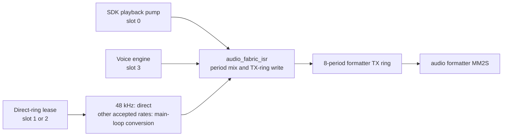

# Audio fabric

The audio fabric mixes SDK playback, direct-ring audio sources and the voice
engine into the formatter TX ring. Firmware advertises it through
`SDK_CAP_AUDIO_FABRIC`, `SDK_SERVICE_FLAG_AUDIO_FABRIC`, and
`SDK_SERVICE_FLAG_AUDIO_FABRIC_RATE`.
The fabric owns the output while a producer is active, so register-driven
legacy playback cannot retarget the formatter during a mixed session.

The formatter runs at 48 kHz. Each 20 ms period is 3,840 bytes of stereo
S16 PCM, or 960 frames. The TX ring has eight periods. The FPGA audio
formatter exposes the MM2S stream interface that reads this ring.

## Audio path



`audio_fabric_isr()` runs from the audio formatter period interrupt. It fills
a bounded period for each live slot, accumulates samples in `int32_t`, clamps
the mix once to S16, flushes the completed TX period, and tracks each slot's
retirement and underrun state. A late, paused, absent, or malformed source
contributes silence for that period. Its underrun counter changes without
blocking the other slots.

The slot table has four entries.

| Slot | Producer | Availability |
| --- | --- | --- |
| 0 | SDK playback pump | Always reserved for firmware |
| 1 | Direct-ring lease | Leaseable when the active bus map provides it |
| 2 | Direct-ring lease | Leaseable on Zorro III; otherwise depends on the bus map |
| 3 | Voice engine | Firmware-owned; attached while a voice session is open |

Zorro III provides two direct-ring grants. Zorro II provides one compact grant
when the generation-2 aperture contract is valid and acknowledged. Older
Zorro II bitstreams provide no grant map, so acquire returns `UNSUPPORTED`.

## Voice engine slot

Slot 3 is the firmware-owned voice slot. The firmware attaches it while a
voice engine session is open and never leases or grants it to a client. An
open session fails with `BUSY` while a register-driven client owns the
output.

The voice engine renders on the core-0 main loop, from
`audio_voice_session_poll()`. It renders whole periods until its frame
counter is the granted lead past the playing frame, and writes them into a
staging ring of 40 periods that serves as the slot's source ring. A poll
call renders one period at most. The main loop runs the poll in the branch
where no Zorro request is pending, and every register access from the 68k
waits while a render runs; 32 interpolated voices cost about 1.0 ms (mono) to
1.4 ms (stereo) a period on the card, measured with the `AUDIO_VOICE_BENCH`
build, and a period with no sounding voice about 2.5 us. Before the mixer ran
in runs per voice the same load cost 3 to 3.5 ms a period, and a call that
rendered all eight periods of the lead after an open or a START held the 68k
for about 24 ms. The main loop calls the poll
many times in a period, so a short lead is rebuilt within a few loop
iterations, with Zorro requests served between the periods. The slot goes
live once the whole lead is staged, because going live primes the TX ring
from the staged periods up to the fill-ahead. A reset stages one silent
period inside its critical section and leaves the rest of the lead to the
poll. A reset before the slot goes live takes back the periods the earlier
polls staged, and the engine timeline restarts at frame 0 (nothing has been
played), so the pre-reset voices never sound. Zorro traffic that never
pauses never reaches the poll's branch, so
the request branch calls `audio_voice_session_poll_busy()`, which polls when
2 ms have passed since the last poll. The
fabric ISR only copies periods out of that ring, as it does for the other
slots, and the slot's retirement gives the playing frame that clients read.
The slot produces 48 kHz stereo S16, so it needs no conversion.

The engine's final stage sums the voices, scales the sums by the Q8.8 master
gain and clamps them to 16 bits. A `CONFIG`
record can switch on a static soft knee between the master gain and the
clamp: samples up to 24576 in magnitude pass unchanged and louder ones are
bent toward the rails, never reaching them. The knee keeps no state, so the
result does not depend on how the render splits its periods, and records
with one stamp apply in ring order, so a `CONFIG` record ahead of the notes
at the lead stamp takes effect before the first note. The firmware advertises
the `LIMITER` feature bit after the card timing gate in
[zz9k-voice.md](../sdk/docs/zz9k-voice.md#limiter-timing); the knee is off
until a client switches it on, and firmware without the bit still accepts the
record when a bench build is under test. The
curve and the client contract are in
[zz9k-voice.md](../sdk/docs/zz9k-voice.md#limiter), and the relation to the
saturation ceilings is in
[audio-saturation-ceiling.md](audio-saturation-ceiling.md).

The engine reads mono S8 and S16 samples and interleaved stereo S8S and S16S
samples (left sample, then right sample) from the session's bank. A frame is
1, 2, 2 or 4 bytes for S8, S16, S8S and S16S, and the byte offsets and
lengths of START and LOOP are divided into frames, rounding down. A stereo
voice multiplies its left sample by the left volume and its right sample by
the right volume, and linear interpolation blends each side with its own
neighbour. Mono output is the same as before the stereo formats existed. The
upload DEFINE accepts format numbers 0 to 3 and refuses the rest without
changing the bank or the sample table. The formats and the rate and pass
helpers in `zz9k/voice.h` are described in
[zz9k-voice.md](../sdk/docs/zz9k-voice.md).

Each voice reads nearest, linearly or with a four-point cubic. A session
default (nearest, linear with the open flag, or the `CONFIG` default
interpolation) applies to a voice until a `MODE` record gives it a setting of
its own, and a fade slot keeps the setting its sound had when it was handed
over. A cubic read overshoots the 16-bit range by up to a quarter, so the
engine applies a cubic voice's volume in 64-bit arithmetic (or the vector
equivalent) and, in a chunk that a cubic voice has added to, takes the
32-bit master product for masters up to 511 instead of 1023; the limiter
holds a sum beyond its last table node at that node. The nearest and linear
arithmetic and its output are unchanged. The firmware accepts cubic, `MODE`
and the default interpolation and advertises the `CUBIC` and `VOICE_INTERP`
bits (features word 0x8F): 32 voices and a full fade pool rendered in at
most 4566 us per 20 ms period across the load matrix in
[zz9k-voice.md](../sdk/docs/zz9k-voice.md#cubic-timing), with no late or
rejected record, underrun or drop. That is a timing result; the cubic output
has not been listened to. The contract is in
[zz9k-voice.md](../sdk/docs/zz9k-voice.md#interpolation).

Closing a session detaches the slot, and a reset clears it. Both drop the
periods already queued in the TX ring and request a rebuild from the
remaining producers, so at most the period the DMA is playing still carries
voice audio. The lead floor is the fabric's fill-ahead plus two periods of
main-loop jitter, eight periods with the default fill-ahead; a low-latency
session shortens the fill-ahead and the floor (see Fill-ahead). The client
contract is in [zz9k-voice.md](../sdk/docs/zz9k-voice.md).

## Fill-ahead

The compositor keeps the TX ring ahead of the DMA by the fill-ahead: six of
the ring's eight periods (120 ms) by default. The fill-ahead is the room the
audio interrupt has to run late. After an interrupt the frontier is
`fill-ahead` periods ahead of the DMA, so an interrupt that finds the DMA at
the frontier has reached a period that was never filled. The fabric then
counts one underrun for each live producer that was owed audio and restarts
the frontier one period ahead. The interrupt can therefore run late by less
than `(fill-ahead - 1)` periods, minus its own run time.

`audio_fabric_fill_ahead_set(periods)` asks for 2 to 6 periods, and 0 gives
the default back. It has one owner at a time. The voice engine's
low-latency session is the only caller: it asks for
`AUDIO_VOICE_LL_FILL_AHEAD_PERIODS` (2) once its slot is attached, and
withdraws the request when the session ends by any route, so close, a missed
heartbeat, the client's exit and a warm reset all restore the default. A
refused open leaves the fill-ahead alone.

The request is written by the main loop and the compositor ISR keeps its own
effective value, so each has one writer. The ISR moves the effective value
once per period, `fabric_fill_ahead_step()` in `audio_fabric.c`. It follows a
lower request at once: the ISR stops filling and the frontier drains by one
period per interrupt, with no period skipped or repeated. It follows a higher
request one period per interrupt, so ending a session never makes one
interrupt fill several periods. Each fill is an uncached 3,840-byte write and
a cache flush on core 0, and `isr_audio` shares a priority with `isr_video`.
Rebase detection keeps the fixed ring bound of six periods, because a rebase
on a lowered target would abandon queued periods whose source bytes are
already staged. An idle fabric and `audio_fabric_reset()` restore the
default.

The fill-ahead applies to every producer while a low-latency session is open.
The pump and the leases play the same samples in the same order, only
sooner, and the host tests check that sequence for fill-ahead 2, 3 and 4
against the default. Their tolerance for a late interrupt shrinks.

| Fill-ahead | Interrupt may run late by less than | Voice lead floor | Main-loop poll gap the floor tolerates |
| ---: | ---: | ---: | ---: |
| 6 (default) | 100 ms | 8 periods, 160 ms | 40 ms |
| 2 (low-latency session) | 20 ms | 3 periods, 60 ms | 20 ms |

The floor is the fill-ahead plus one period for a main loop that polls the
voice engine in every 20 ms window, plus one period for each further 20 ms of
gap the poll may show. The default floor carries one extra period of margin.
The last column is `(lead - fill-ahead) * 20 ms`, less the time the engine
needs to render a period. The status block reports the largest poll gap seen
and the smallest time a rendered period waited for the ISR, which is how a
client picks its lead. Hardware measurements of the two settings are not
recorded here.

## Ownership and direct rings

The fabric has three ownership states: `AUDIO_FABRIC_IDLE`,
`AUDIO_FABRIC_LEGACY_EXCLUSIVE`, and `AUDIO_FABRIC_ACTIVE`. A legacy playback
client owns the formatter during `AUDIO_FABRIC_LEGACY_EXCLUSIVE`. A fabric
producer cannot attach in that state. The first fabric producer resets the TX
buffer to `AUDIO_TX_BUFFER_ADDRESS`; later producer changes leave the
formatter configuration unchanged.

A direct-ring client uses the audio service opcodes below. The client writes
PCM into the granted board-visible ring and publishes its producer line. PCM
does not pass through mailbox payloads.

| Opcode | Value | Operation |
| --- | --- | --- |
| `SDK_OP_AUDIO_FABRIC_STATE_GET` | `0x0512` | Read one slot's framed state |
| `SDK_OP_AUDIO_RING_ACQUIRE` | `0x0513` | Acquire a generation-bound PCM ring and control block |
| `SDK_OP_AUDIO_RING_RELEASE` | `0x0514` | Release a generation-bound lease |

The audio service advertises 28 opcodes, `0x0500` through `0x051B`. The
retired copy-submit range `0x050f` through `0x0511` remains reserved, as do
`0x0501` and `0x0502`. The voice engine opcodes `0x0518` through `0x051B` are
inside the count, and the voice service flag is set on Zorro III only.

A successful acquire zeroes the PCM ring and control block, publishes a fresh
generation, and begins in `LEASED`. The slot becomes `ACTIVE` after the first
valid producer-line publication. A release stops the contribution, rebuilds
queued periods from the remaining producers, and advances the generation. A
release with a stale generation is idempotent. Firmware revokes a lease after
a 2,000 ms heartbeat timeout.

`SDK_OP_AUDIO_FABRIC_STATE_GET` reports the slot state, identity, generation,
written and consumed byte cursors, heartbeat age, underruns, 16.16 peak, and
clip count. A state read with `HOLD_RESET` requests reset of the lease peak
window.

## Producer ring cache ownership

The compositor copies each period out of the producer's PCM ring from the
formatter interrupt on core 0. What it does first depends on how the producer
wrote the ring, which the producer states in its source snapshot
(`struct audio_fabric_source`). A snapshot starts zeroed, so a producer is
non-coherent unless it sets `coherent`.

| Producer wrote the ring | Snapshot | Reader step before the copy |
| --- | --- | --- |
| By DMA, through the Zorro aperture, or cleaned to DDR before it published the index | `coherent` = 0 | Invalidate the range, so a stale cached copy is dropped |
| With cacheable, shareable stores on a core in the SCU coherency domain | `coherent` = 1 | An acquire barrier only; the loads see the producer's dirty lines in L1 or L2 |

An invalidate must not run over a coherent producer's ring. The newest PCM can
be dirty in the producer's L1 or in L2 and not yet in DDR, and an invalidate
by address discards those lines, so the copy reads whatever DDR held from the
ring's previous lap. That plays as distortion. An app on the platform audio
route is such a producer: it stores PCM through its own cacheable alias of the
ring, and the app cannot clean its cache. The playback pump, the media
session and the direct-ring leases stay non-coherent. The queued-period
replay after a peer detaches follows the same rule as the first read.

The barrier orders the ring loads after the producer's published write index,
which the snapshot read. The producer's side of the pair is a release barrier
between its PCM stores and the index store.

## Source formats, conversion, and admission

A zero-flags acquire is a 48 kHz stereo S16LE bypass lease. A client can set
`SDK_AUDIO_RING_ACQUIRE_FLAG_SOURCE_RATE` and supply a source rate. The
mailbox currently accepts 8000, 12000, 24000, 32000, 44100, or 48000 Hz.
`SDK_AUDIO_RING_ACQUIRE_FLAG_SOURCE_S16BE` is valid only with the source-rate
flag.

A direct-ring lease at 48 kHz feeds the compositor directly. A lease at any
other accepted rate is converted into 48 kHz periods by
`audio_fabric_lease_poll()` on the core-0 main loop. The ISR copies those
staged periods; it does not run the lease FIR conversion.

At most two live producers may require conversion across the pump and the two
lease slots. A 48 kHz bypass lease may acquire a free slot. An acquire that
would exceed the conversion limit returns `BUSY`. The SDK playback pump also
counts when its bound source rate differs from 48 kHz. The voice slot renders
at 48 kHz and never needs conversion.

| Capability or flag | Value | Meaning |
| --- | --- | --- |
| `SDK_CAP_AUDIO_FABRIC` | bit 27 | Audio fabric is available |
| `SDK_SERVICE_FLAG_AUDIO_FABRIC` | bit 22 | Direct-ring audio fabric is available in the audio service |
| `SDK_SERVICE_FLAG_AUDIO_FABRIC_RATE` | bit 23 | Source-rate leases are available |
| `SDK_SERVICE_FLAG_AUDIO_VOICE` | bit 28 | Voice engine opcodes are advertised. The firmware sets it on Zorro III; it is not set on Zorro II yet |
| `SDK_SERVICE_FLAG_AUDIO_VOICE_STEREO` | bit 29 | The voice engine's stereo sample formats are advertised. The firmware sets it on Zorro III with the voice flag; it is not set on Zorro II yet |

Clients should check the capability and service flags before using the
opcodes. Firmware that does not recognize the source-rate flag returns
`BAD_REQUEST`.

## Instrument build

Defining `AUDIO_FABRIC_BENCH` enables firmware-only accounting. The build
uses the existing `EXTRA_CFLAGS` seam:

```
make -C ZZ9000_proto.sdk/ZZ9000OS EXTRA_CFLAGS='-DAUDIO_FABRIC_BENCH'
```

`audio_fabric_bench_poll()` runs from the main loop and prints one aggregate
block per second. The ISR does not print. The report uses ARM global-timer
ticks. `COUNTS_PER_SECOND` is half the 666.67 MHz core clock, so two ticks
equal one CPU cycle.

| Report row | Measured region |
| --- | --- |
| `isr` | An active compositor tick from frontier check through tail tracking |
| `phase` | How far into its 20 ms period the DMA already was when the compositor ran: the largest value in microseconds and a histogram with edges at 0.5, 1, 2.5, 5 and 10 ms |
| `mix` | Mix clear, per-slot accumulation, S16 clamp, and TX cache flush |
| `slotN fill` | Slot N fill, including source pull, byte order handling, metering, expansion, and gain |
| `slotN conv` | Slot N conversion work measured by the compositor |
| `frontier`, `txzero`, `slotN starve`, `slotN zero`, `slotN ring` | DMA movement and source-availability diagnostics |

Each timing region includes two timer reads. Compare stage rows with the
`isr` row instead of summing them.

For a hardware measurement, record the active producer configuration, the
`isr` and `mix` average and peak values, every active `slotN fill` value,
conversion rows when present, and underrun or starvation counters. Test the
48 kHz pump, a converted pump, one bypass lease, and two direct-ring leases.
Repeat the converted case with a rate-bearing lease to exercise both admitted
conversion slots.

## Hardware results

One bench session on 2026-08-28 (PAL A4000, R1 card) qualified the fabric.
It ran before #110 moved lease rate conversion out of the ISR. Every row ran
with core-1 MP3 decode and a full-screen RTG window drag in progress. The
per-stage timing blocks were not kept, so the results are pass/fail only.

| Row | Producers | Result |
| --- | --- | --- |
| B1 | Pump alone, 48 kHz | Pass, 0 underruns |
| B2 | Pump alone, 44.1 kHz conversion | Pass, 0 underruns |
| B3 | B2 plus one 48 kHz lease | Pass, 0 underruns |
| B4 | B2 plus two direct-ring leases | Pass, 0 underruns |

The same session passed these checks:

- Pump and lease audio mixed with no dropouts or level jumps.
- Underrun counters stayed at 0 for active slots.
- Rapid acquire, feed and release cycles left at most one residual period per
  release.
- A warm reset with two producers active left no stale audio, and handles
  from before the reset no longer validated.
- Framed state reads through `zz9k-fabriclease`, without ZZTop, were
  self-consistent.

Two-stream listening under RTG and network load also ran with no audible
drops. No session has measured two converting producers at once.

### ZZPlay beside a 32-voice low-latency voice session

A second session on 2026-11-23 ran `ZZPlay --fps --audio=ax` on a PAL
MPEG-2 file with 48 kHz MP2 audio (750 pictures, 1440000 audio frames, about
30 s), and started `zz9k-voiceplay LOAD VOICES=32 SECONDS=15 STEREO
RATE=96000 RAMP=256 GAIN=65535 CHURN GROUPS=32 LIMITER INTERP=linear LOWLAT`
about 5 s into the movie. The pump, the media session and the voice slot
shared the compositor, and the fill-ahead went from 6 periods to 2 and back.

Before the owner check in `CLIENT_RELEASE`, the movie stopped at 19.44 s
(933120 of 1440000 audio frames) when the voice tool exited and closed
`zz9k.library`. The release stopped the media pump of a session the tool did
not own. The movie then held its next picture until it was interrupted. With
the check, the pump stays bound and the movie ran on after the voice tool
exited.

| Measure | Result with the check |
| --- | --- |
| ZZPlay wall time | 30306 ms, normal end of file |
| Pictures | 750 decoded, 477 presented, 273 discarded |
| Audio | 1440000 frames played, 0 underruns |
| A/V sync | 273 late pictures, 637 holds, largest drift 260 ms |
| SDK calls, per call | write 8390 us, decode 12825 us, retire 2842 us |
| Voice session | late counter 240 voice records, 0 rejected, 0 underruns, 0 dropped |
| Voice host pacing | largest wait 67876 us against 5000 us asked, first late at 3.224 s |

The release fix removes the freeze. It does not qualify the combination:
the same movie plays 750 pictures with no discards when it runs alone, and
with the 32-voice low-latency load running, 273 pictures were discarded and
the voice late counter read 240 records. That counts late voice records, not
late periods: with `CHURN GROUPS=32` and `RAMP=256` one 20 ms producer period
carries 240 records, and the first late record was one such window. The cause
of the late pictures and records is not established. The voice host waits of
up to 67876 us fit the mailbox and main-loop stalls that are already open.
Qualifying ZZPlay beside this voice load stays an open item until a run
presents all pictures with a late counter of 0.

## History

| Earlier ABI state | Current rule | Reason retained in the ABI |
| --- | --- | --- |
| Copy-submit lease transport used `0x050f` through `0x0511`. | Those values remain reserved. Direct-ring operations start at `0x0512`. | Existing opcode values remain stable. |
