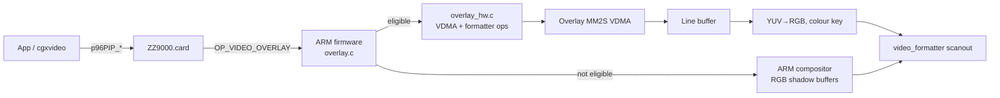

# Native P96 PIP (video overlay)

The ZZ9000 shows Picasso96 PIP windows with a dedicated overlay plane in the
FPGA. The PL fetches the YUV source straight from DDR, converts it to RGB, and
composites it into the display while scanning out. The ARM only programs the
plane and hands over new frames at vblank. When the PL plane can't handle a
window, the ARM software compositor takes over, as it did before the plane
existed.

Applications don't need to change. Programs that call `p96PIP_*` directly,
and programs that go through cgxvideo, use the same driver path.

## How a frame reaches the screen

The driver sends `OP_VIDEO_OVERLAY` with:

- the P96-managed source bitmap and its real pitch
- the YUV422 layout
- the destination rectangle
- the active flag and the colour key

The firmware checks this against the current screen mode and picks a path.

**P96 sources.** The VDMA reads the packed YUV422 bitmap that P96 owns. It
rescans that bitmap every frame, so a new picture written by the application
appears without any work from the ARM.

**SDK video sessions** (ZZPlay and other `zz9k.library` players). The decoder
outputs planar 4:2:0. Core 1 packs each frame into one of two packed-YUV422
staging buffers that are not being scanned. At vblank, core 0 flushes the
caches and points the VDMA at the new buffer. Frames larger than 1280x720 are
packed at half size, and the plane scales them back up. This lets a 1080p
stream play natively in a 1280x720 window.

## When the native plane is used

The native plane is used when all of these hold:

- The firmware was built with the hardware backend (not
  `ZZ9000OS-legacy-bitstream.elf`).
- The window is active, has a positive size, and at least part of it is on
  screen. The window may extend past any screen edge; the PL clips it.
- The window is at least as large as the scanned source in both directions.
  A P96 source is scanned at full size. An SDK frame over 1280x720 is scanned
  at half size.
- The source is no larger than 2560x4095.

Everything else goes to the ARM compositor. The case that comes up most often
is a window smaller than its source: a PIP the user has shrunk, or ZZPlay
letterboxing an anamorphic frame onto a screen at the coded size. See
[Known limitations](#known-limitations).

Both paths reject a PIP when the screen uses scan-doubled modes (`scalemode`
≠ 0) or an 8-bit CLUT depth. In that case the PIP fails to open; the firmware
doesn't show an invisible overlay.

Switching between paths drops any staged frames. The hardware path stages
packed YUV and the software path stages full RGB screens, so a frame staged
for one path is never shown on the other.

## Hardware

- **Second VDMA.** An MM2S VDMA for the overlay shares HP0 with the main
  scanout through a two-input AXI interconnect. Main scanout has AXI priority
  15 and the overlay has 0, so a busy overlay can't starve the desktop. The
  overlay reads DDR 64 bits at a time.
- **`video_overlay_linebuffer.v`.** Ping-pong line buffers. The fetcher
  requests source row N+1 as soon as row N is ready, and fills the other bank
  while row N is displayed. Fetch requests, completed-row tags, and generation
  acknowledgements cross between the 100 MHz AXI clock and the pixel clock
  through three `xpm_cdc_handshake` instances.
- **`video_overlay_pixel.v`.** Converts YUV to RGB using CCIR601 coefficients,
  for all five packed YUV422 layouts. It compares each pixel with the RGB colour
  key.
- **`video_formatter.v`.** Maps destination pixels and rows to source
  coordinates, using nearest-neighbour scaling. It computes the scale steps
  outside the pixel critical path. Line-buffer banks are not tied to source
  row parity, which lets the fetcher skip rows. The overlay is composited
  before the sprite and scanline post-processing, so the hardware pointer stays
  on top.

The firmware programs the formatter through video-control ops 22–27, defined
in `video.h`:

| Op | Name | Data |
|---|---|---|
| 22 | `MNTVF_OP_OVERLAY_CTRL` | enable, key enable, source mode, YUV422 layout |
| 23 | `MNTVF_OP_OVERLAY_POS` | signed destination Y:X |
| 24 | `MNTVF_OP_OVERLAY_SIZE` | destination H:W |
| 25 | `MNTVF_OP_OVERLAY_KEY` | colour key as RGB888 |
| 26 | `MNTVF_OP_OVERLAY_SOURCE_SIZE` | source H:W |
| 27 | `MNTVF_OP_OVERLAY_FRAME` | frame generation token |

The VDMA address, pitch, HSIZE and VSIZE are AXI-Lite registers, written by
`overlay_hw.c`. Geometry and control changes take effect at vblank.

### Frame handoff

The handoff runs in this order. Each step fixed a bug seen on hardware:

1. At vblank, the ARM does the full L1+L2 cache flush first.
2. It resets and reprograms the overlay VDMA, writing `START_ADDR` first and
   `VSIZE` second. A running AXI VDMA only uses a new start address after
   `VSIZE` is written (AMD PG020).
3. It advances the frame generation.
4. The formatter holds at the end of the previous frame until the line-buffer
   side acknowledges the new generation. Only then does it request line zero.

The VDMA is connected directly to the line fetcher with no FIFO in between, so
no data from the old frame can survive the reset.

## Firmware and bitstream must match

The firmware and the bitstream share an ABI, and release packages have to pair
them. The default firmware expects formatter RTL that includes the overlay
plane. `ZZ9000OS-legacy-bitstream.elf` is built with the hardware backend
switched off at compile time. It runs on older bitstreams and always uses the
ARM compositor.

## Status

**Default `zorro3` passes on hardware:**

- **Playback.** 640x480@30 MPEG-1 at exact size shows correct video with no
  flicker. Paced playback runs at about 27–28 fps. Uncapped, it reaches
  69.1 fps playback and 93.1 fps decode-call. A 318x240 clip, whose width is
  an odd number of macroblocks, runs at 23 fps playback and 209 fps
  decode-call.
- **Window operations.** Moving, partial clipping and obscuring, resizing,
  closing and reopening produce no artifacts.
- **Depths.** Correct at 1280x1024 in both 16-bit and 32-bit.
- **Players.** RiVA works through native P96 PIP and also through cgxvideo.
- **Interaction with other features.** DPMS, the live scanline modes
  off/classic/soft/gradient, and taking over native video or videocap and
  returning all work. The scanline result shows that changing the control
  doesn't disturb the PIP. It doesn't show visible shading drawn together with
  the PIP: high-resolution RTG suppresses shading, and P96 modes scaled down to
  low resolution can't show an overlay.
- **Clean shutdown.** After closing, core 1 stays online, there are no failed
  requests and no live buffers or surfaces, and the whole 4,128,768-byte
  shared heap is free.
- **Upscaling.** The same 640x480@30 clip with direct AX audio, at exact size
  and in an enlarged window:

  | Metric | Exact size | Enlarged |
  | --- | ---: | ---: |
  | Decoded frames | 4,405 | 4,405 |
  | Presented frames | 4,379 | 4,374 |
  | Discarded or late frames | 26 | 31 |
  | Average playback | 29.916 fps | 29.925 fps |
  | Audio underruns | 13 | 10 |

  The presented-ratio difference (0.0011) is under the 0.002 noise threshold,
  and the two runs looked the same.

**Simulation and timing:**

- `video_overlay_pixel` simulation covers layout, luma, clamping and the key
  for all five layouts.
- The formatter xsim sweep passes 12 of 12 configurations, with zero pixel
  mismatches. The sweep covers:
  - 32/16/15-bit base modes
  - odd widths
  - a 1920-pixel full-width line
  - non-integer up- and downscaling
  - negative-edge clipping
- The line-buffer xsim covers:
  - stalls and resync after an unexpected SOF
  - bank wrap
  - disable and source-generation invalidation
  - a generation programmed while the overlay is disabled
- The scaling build meets timing in Vivado 2018.3: +0.917 ns setup WNS and
  +0.017 ns hold WHS on the pixel clock. All overlay CDC paths are recognised
  XPM handshakes.

**Not yet qualified on hardware:**

- The six non-default board variants. Their bitstreams pass synthesis,
  implementation, DRC, bus-skew and timing. Hardware acceptance has been
  recorded only for default `zorro3`.
- Wider clipping and scale-ratio coverage, which is part of the release
  matrix.

## Known limitations

- **No native downscaling.** Every hardware test with a window smaller than
  its scanned source showed the first rows of the frame and then black. On an
  A4000 this happened with a 1920x1080 window and with a 720x576 MPEG-2 frame
  letterboxed to 720x405, while 1:1 and enlarged windows of the same clips
  were correct. The line fetcher fetches one source row per displayed row,
  which is the likely cause. The firmware sends these windows to the ARM
  compositor, even though downscaling passes in xsim.
- **Colour-key occlusion is opportunistic.** Other windows on top of the PIP
  hide it only where the colour key matches.
- **SDK frames still need a pack step.** Core 1 converts each planar 4:2:0
  frame to packed YUV422 before the plane can read it.

## Next step: planar 4:2:0 fetch

The plane would read Y, Cb and Cr directly, using explicit fences between the
display and decode buffers. The decoder could not reuse a displayed frame
until the PL had passed its last visible overlay line. That removes the core 1
pack step. P96 would still own the window geometry and lifetime.

## Bring-up history

The 1:1 plane needed nine hardware revisions (r3–r9b) before it showed
correct video. The list gives the main faults in order. Each fix is still in
the design.

| Rev | What was seen | Cause and fix |
|---|---|---|
| r3 | Corrupt, flickering output below and outside the PIP | Main scanout starved on the shared HP0 port. Fixed by giving main scanout AXI priority, using 64-bit overlay reads, starting the next-row prefetch at the PIP's last pixel, allocating staging buffers with the P96 pitch, and making formatter register writes IRQ-atomic. An off-by-range XPM line-buffer declaration was also fixed; Vivado had already rounded the BRAM, so this didn't change the bitstream. |
| r5 | PIP solid cyan | The VDMA kept scanning the cleared P96 source. A new `START_ADDR` only takes effect after `VSIZE` is written. |
| r6 | Two frames superimposed vertically, with flicker | The formatter started line zero at vblank, before the ARM's cache flush and address commit. Replaced with the acknowledged generation handoff and a VDMA reset each frame, and the overlay FIFO was removed. |
| r7 | Mostly correct, still flickering | A full-width row had only horizontal blanking to load. Fetching and displaying a row became separate steps, so row N+1 is fetched while row N is shown. |
| r8 | Worse flicker and random black rows | Row numbers, tags and valid flags crossed clock domains bit by bit. Replaced with bundled `xpm_cdc_handshake` transfers. |
| r9 | Correct, no flicker | First hardware pass. |
| r9b | PIP failed to open on a 16-bit Workbench | `ZZ_CreateFeature` in the driver always asked for half-width storage, which only gives the right packed-YUV pitch with a 32-bit friend bitmap. It now sizes the allocation from the friend's bytes per pixel and keeps a whole final YUV pair for odd widths. |

Nearest-neighbour scaling and clipping in the PL came later, in #64. Before
that, any resized or clipped window used the ARM compositor. Downscaled
windows were moved back to the compositor after the hardware failures
described under [Known limitations](#known-limitations).

## Comparison with Z3660

The [Z3660](https://github.com/shanshe/Z3660) design was reviewed at `main`
`1dddf79` (2026-07-22). It also uses a second VDMA, but has a single line buffer
and fetches the next row at the visible-line boundary. Its own formatter source
notes a VDMA switch timing window that causes a flickering line. It has no
generation acknowledgement or ready tags, so ZZ9000 has nothing to take from
it here. The fetch/display split described above addresses the same problem
more thoroughly.

Its MPEG-1 player does more of the work on the ARM. It buffers up to 1 MiB,
copies FIFO data through a temporary allocation, converts planar output to
RGB32 on the ARM, and flushes the whole RGB surface. ZZ9000 streams straight
into the demuxer, keeps decoder-owned planar frames, writes only the packed
YUY2 staging buffer, and does YUV-to-RGB conversion and composition in the PL.

The NEON motion-compensation and IDCT experiments in Z3660's vendored
`pl_mpeg.h` are not bit-exact, so they can't be copied over:

- Its nested rounded averages don't always match MPEG's four-sample formula.
- Several IDCT expressions apply the rounding bias twice: once explicitly,
  then again through a rounding shift.

ZZ9000 decodes MPEG-1 and MPEG-2 with libmpeg2. Its NEON kernels in
`sdk_mpeg2_neon.c` compute the same results as the C code. The card runs a
one-off comparison against the C code before installing them and keeps using
C if they differ.
`test/mpeg2_neon/run.sh` runs the same comparison under qemu-arm.
