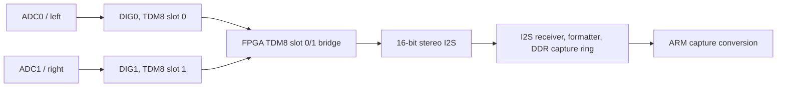

# ZZ9000AX DIG0 feasibility gate

`DIG0` alone is excluded for lossless 48 kHz stereo capture. One 48 kHz
serial slot contains at most 24 programmable bits, while two signed 16-bit
samples need 32 bits before any framing. The packaged transport is 16-bit
TDM8. The ADAU1701 puts `DIG0` and `DIG1` in slots 0 and 1, then the FPGA
converts them to conventional stereo I2S for the existing capture path.

`ax.c` writes `ZZ_AUDIO_CODEC_SERIAL_TDM8_SLOT01` (`0x0c22`) to serial-output
register `0x081e`. `zz9000ax/README.md` identifies this configuration as
48 kHz, 16-bit TDM8 master mode with a 256*Fs (12.288 MHz) BCLK. The decision
records a local feasibility analysis. Hardware transport testing was outside
its scope.

## Current transport

The capture interface remains 16-bit stereo I2S. `zz9000_project.tcl`
configures `i2s_receiver_0` and `i2s_transmitter_0` as 16-bit slaves. Its
`audio_clock_0/bclk_out` net clocks both IP cores, and
`audio_clock_0/mclk_out` clocks both cores and `audio_formatter_0`.
`I2SO_LRCLK` enters `audio_clock_0/lrclk_in`; its IOB input register drives
the transmitter through `audio_clock_0/tx_lrclk_out`, rather than feeding the
transmitter directly from the pad.

The current capture implementation converts completed 48 kHz S16LE stereo DMA
periods with `audio_convert.c`. The shared integer-only conversion kernel is
used by AHI playback, SDK preconversion, and capture. It supplies rate
conversion. The source has no implementation of a 96 kHz alternating `DIG0`
transport.

## Why one DIG0 slot was rejected

The ADAU1701 serial output supports I2S, left/right-justified formats, and
8-channel TDM. A serial slot has at most 24 programmable data bits. The codec
data sheet is the source for those limits: [ADAU1701 Rev. C data
sheet](https://www.analog.com/media/en/technical-documentation/data-sheets/ADAU1701.pdf),
Serial Data Input/Output Ports, pp. 45–46.

| Requirement | Bits per 48 kHz frame |
| --- | ---: |
| Left signed PCM | 16 |
| Right signed PCM | 16 |
| Minimum payload | 32 |
| One `DIG0` slot | 24 |
| Deficit before framing | 8 |

Packing both channels into one slot loses at least eight bits before a channel
marker or recovery framing is added. Two 12-bit samples, one full-width sample
with a reduced second sample, and lossy compression do not meet the lossless
signed-16 requirement.

## 96 kHz alternate-frame proposal

A 96 kHz, 24-bit slot has enough aggregate capacity for one signed 16-bit
sample and an 8-bit channel tag per transport frame. Alternating tagged left
and right samples could make channel identity recoverable after reset, or a
dropped or duplicated frame.

The proposal lacked a complete design. The ADAU1701 has 512 instruction cycles
per sample at a 96 kHz core rate, rather than 1024 at 48 kHz (data sheet,
Programming, p. 29 and DSP Core Control Register). The earlier production
graph reached the 48 kHz resource boundary when extra capture processing was
added. The proposal also changes the clocking seen by the existing I2S receiver
and transmitter, which share `audio_clock_0/bclk_out`.

The checked-in ARM sources show a fixed 48 kHz capture path and an ARM
conversion kernel. They do not show a separate 96 kHz `DIG0` receiver,
clock-domain crossing, buffering contract, or capture-monitoring proof for
this proposal.

## Open items

The packaged TDM8 slot-0/1 transport needs no DIG0-only work. A DIG0-only mode
can be reconsidered only with a complete design that provides:

- two lossless signed 16-bit channels at 48 kHz each;
- channel identity and recovery across reset and missing or repeated frames;
- conversion back to the existing 48 kHz stereo capture path without changing
  ordinary playback timing; and
- contemporaneous capture monitoring, including the required clock-domain,
  buffering, reset, and rate-conversion contracts.

## Decision history

| Date | Decision | Reason retained |
| --- | --- | --- |
| 2026-07-28 | `NOT_PACKAGED_FEASIBILITY_FAIL` | A 48 kHz one-slot design is eight bits short before framing. The 96 kHz alternate-frame proposal had no complete DSP and clocking design. |
| Current | TDM8 slot 0/1 | The production firmware and codec configuration use `DIG0` and `DIG1` as the two stereo slots. |
