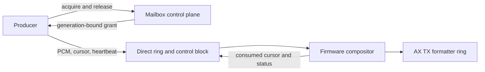

# Direct Audio Producer Rings - Plan

## Status

Direct producer rings are implemented. Producers acquire a generation-bound,
host-visible PCM ring, write PCM directly, and publish their cursor and
heartbeat through a shared control block. The steady PCM path does not use a
mailbox request.

| Unit | Status | Current implementation |
| --- | --- | --- |
| U1. Direct-ring ABI | Implemented | `sdk/include/zz9k/abi.h` defines the opcodes, grants, 64-byte producer and firmware control lines, 3,840-byte bypass periods, and ABI checks. `sdk/include/zz9k/audio.h` and `sdk/host/include/zz9k/host.h` expose builders and session APIs. |
| U2. Bus-specific grants | Implemented | `ZZ9000_proto.sdk/ZZ9000OS/src/memorymap.h` reserves two 16-period Zorro III rings and one 12-period Zorro II ring. The Zorro II reservation is 48 KiB; the generation-2 host-window heap is 16 KiB. `audio_fabric_lease.c` selects the map at acquisition time. |
| U3. Firmware producer path | Implemented | `audio_fabric_lease.c`, `audio_fabric.c`, `audio_fabric_internal.h`, and `sdk_mailbox.c` validate control lines, mix complete periods, publish credits, isolate bad cursors, and rebuild queued periods after detach. |
| U4. SDK client path | Implemented | `sdk/host/src/zz9k_host.c` maps validated grants and implements the session helpers. `sdk/tools/zz9k-fabriclease.c` is the proof client. `audio_ring_contract_test` and `audio_ring_client_test` are registered in `sdk/CMakeLists.txt`. |
| U5. Recovery | Implemented | Firmware uses a 2,000 ms heartbeat timeout in `audio_fabric_lease.c`. Release, revocation, and warm reset invalidate generations and request a queued-period rebuild. |
| U6. Cutover and diagnostics | Implemented | The copy-submit range `0x050f` through `0x0511` is retired and reserved. Direct-ring operations use `0x0512` through `0x0514`; state reads remain available. The firmware and SDK retain direct-ring tests. |
| U7. Hardware qualification | Partial record | `docs/audio-fabric.md` records a 2026-08-28 Zorro III session, including two direct-ring leases with 0 underruns, release residual bounds, and warm reset. This plan contains no recorded Zorro II hardware result for the planned one-slot admission case. |

The capability is currently advertised through `SDK_CAP_AUDIO_FABRIC` and
`SDK_SERVICE_FLAG_AUDIO_FABRIC`. That differs from the original gate in R17,
which required every planned hardware example before advertising. The source
records the gate as passed, while the retained hardware record does not show a
Zorro II run.

No source implementation unit is otherwise partial. Package checksum refreshes
were a release procedure in U6, not a retained implementation record.

## Original outcome

The plan replaced an unadvertised copy-submit lease transport with a direct
shared-ring producer ABI. It was intended to let independent audio producers
run concurrently without serializing PCM transfers through the global mailbox
semaphore.

The direct plane has these rules:

- A client acquires one slot and receives its ring address, capacity, control
  address, period geometry, sample contract, generation, and active-bus slot
  count. Clients derive placement from that grant.
- The producer writes PCM before it publishes the matching write cursor and
  heartbeat. Firmware consumes complete periods only and publishes its
  consumed cursor as credit.
- Producer and firmware state occupy separate 64-byte, big-endian seqlock
  lines. A stale generation, unstable control line, backward cursor, or cursor
  distance greater than capacity fails the affected slot without moving the
  shared TX frontier.
- Zorro III admits two direct slots. An acknowledged generation-2 Zorro II
  aperture admits one compact slot; a second acquisition is refused. Older
  Zorro II layouts expose no direct-ring map.
- A producer must refresh its heartbeat even while paused. Firmware revokes a
  heartbeat that has not changed for 2,000 ms, invalidates the generation, and
  lets another client acquire the slot.
- On release, revocation, or warm reset, firmware rebuilds queued TX periods
  from live producers. Only the DMA period in progress may retain removed
  audio.

The original bypass format was 48 kHz stereo S16LE, with a 3,840-byte,
20 ms period. The implementation later added negotiated source-rate S16LE
leases for 8,000, 12,000, 16,000, 22,050, 24,000, 32,000, 44,100, and
48,000 Hz. Firmware converts non-48 kHz leases on the core-0 main loop.

## Decisions retained from planning

| Decision | Reason |
| --- | --- |
| Use a direct-ring ABI instead of copy-submit calls. | Synchronous complete-call waits could not sustain two producers. |
| Keep PCM outside the mailbox data path. | The mailbox remains the control plane for acquire, release, and state reads; it does not pace playback. |
| Put producer and firmware fields in separate cache lines with big-endian seqlocks. | Each side can publish its state without sharing a writable cache line, and firmware can reject a torn snapshot. |
| Grant memory through firmware instead of client constants. | The active bus map determines safe addresses, capacity, and slot count. |
| Reserve one Zorro II slot. | The 64 KiB host-visible window could reserve 48 KiB for direct audio while leaving a 16 KiB general heap. It could not safely reserve two slots. |
| Revoke after two seconds of heartbeat inactivity. | A crashed producer must not retain a slot until reset. |
| Rebuild queued periods after a slot disappears. | Queued mixed periods must not replay samples from an inactive generation. |
| Remove copy-submit compatibility code. | The transport was unadvertised, so a clean ABI cutover avoided maintaining two producer paths. |

## Original contract

### Requirements

| Area | Requirement |
| --- | --- |
| Negotiation and isolation | Acquisition returns a generation-bound grant. Granted data and control ranges cannot overlap one another, formatter rings, legacy audio scratch, boot memory, allocators, or firmware-owned memory. Cooperative clients retain physical aperture access after revocation, so firmware rejects stale generations. |
| Steady path | PCM writes and cursor publication require no synchronous mailbox call. Firmware accepts only visible, complete periods; publishes consumed credit; checks cursor distance; and attributes starvation per slot. |
| Admission | Zorro III provides at least two direct slots. Zorro II provides exactly one negotiated compact slot and deterministically refuses another. Capability and grants report the active geometry. |
| Lifecycle | Live and paused producers refresh a shared heartbeat. At two seconds of inactivity, firmware revokes the generation, stops consumption, and permits reacquisition without reset. Release, revocation, and reset allow at most one 20 ms residual period. |
| Observability | State reports generation, cursors, heartbeat or revocation state, starvation count, peak, and clip count without changing playback pacing. |
| Cutover | The direct transport replaces copy-submit leases. Retired submit opcodes and client paths are removed, while their numeric values stay reserved. |

### Data and control flow

The producer line contains the generation, write cursor, heartbeat, and flags.
The firmware line contains the generation, consumed cursor, and status. Both
cursors are 64-bit values encoded as big-endian 32-bit words. Firmware flushes
published credits and invalidates only newly credited PCM ranges.

## Implementation record

### ABI and client

`ZZ9K_OP_AUDIO_FABRIC_STATE_GET`, `ZZ9K_OP_AUDIO_RING_ACQUIRE`, and
`ZZ9K_OP_AUDIO_RING_RELEASE` are `0x0512`, `0x0513`, and `0x0514`.
The retired copy-submit range is `0x050f` through `0x0511` and is never reused.

The SDK validates grant size, alignment, aperture placement, generation, and
sample contract before returning mapped pointers. It provides wrapped writes,
producer publication, firmware-credit snapshots, heartbeat refresh, state
reads, and release. The proof client writes a generated tone into its granted
ring and uses low-rate state telemetry only for observation.

### Memory and admission

| Bus | Slots | Ring capacity | Placement rule |
| --- | --- | --- | --- |
| Zorro III | 2 | 16 periods, 61,440 bytes each | Two 64 KiB blocks immediately before the Z3 audio scratch region. |
| Zorro II | 1 | 12 periods, 46,080 bytes | A 48 KiB direct-ring reservation between the generation-2 host-window heap and audio scratch. The remaining host-window heap is 16 KiB. |

Zorro II acquisition requires a valid, acknowledged generation-2 aperture
layout. Without it, the firmware reports no direct-ring map. The aperture tests
check the reservations, alignment, non-overlap, and the arithmetic that makes a
second Zorro II grant impossible.
The original reservation change also required matching layout-generation work in
the SDK, firmware, FPGA layout metadata, and RTG driver. This repository records
the firmware and SDK portions. The RTG driver and FPGA metadata remain owned by
their respective repositories.

### Firmware lifecycle

The mailbox dispatcher owns acquisition, release, and state requests. The
main loop runs `audio_fabric_lease_poll()` for conversion-bearing leases. The
compositor validates and stages direct-ring periods, while the ISR does not run
the source-rate conversion.

The firmware tests cover publication ordering, partial periods, wrapping,
invalid cursors, stale and paused heartbeats, a permanently odd seqlock,
release and revocation rebuilds, and warm reset. SDK tests cover grant
validation, independent contexts, Zorro II second-slot refusal, credit pacing,
and Ctrl-C release.

## Historical acceptance record

The planned acceptance cases were:

| Case | Planned result |
| --- | --- |
| AE1 | A 44.1 kHz pump and two Zorro III direct-ring clients run for at least 60 seconds under RTG load without steady starvation, recurring frontier rebases, or pacing mailbox traffic. |
| AE2 | One Zorro II producer remains clean for at least 60 seconds and a second request is refused without changing the active producer. |
| AE3–AE4 | Firmware consumes only published, complete periods and isolates a backward or over-capacity cursor to its own slot. |
| AE5–AE7 | Heartbeat expiry, stale generations, release, and warm reset reclaim or invalidate the slot without replay beyond the current 20 ms period. |

The recorded 2026-08-28 hardware session used a PAL A4000 with an R1 card,
core-1 MP3 decode, and a full-screen RTG window drag. It recorded these results:

| Row | Producers | Result |
| --- | --- | --- |
| B1 | 48 kHz pump | Pass, 0 underruns |
| B2 | 44.1 kHz converted pump | Pass, 0 underruns |
| B3 | B2 plus one 48 kHz direct lease | Pass, 0 underruns |
| B4 | B2 plus two direct leases | Pass, 0 underruns |

The same record reports no audible dropouts or level jumps, zero active-slot
underruns, at most one residual period after rapid release, correct warm-reset
invalidation with two producers, and self-consistent framed state reads.
Two-stream listening under RTG and network load also had no audible drops.
No recorded session measured two converting producers, and no retained record
covers the planned Zorro II hardware acceptance case.

## Scope and superseded work

The plan did not change decoder algorithms, sample-rate conversion quality,
scene policy, overlay VDMA restart behavior, or generalized zero-copy SDK
services. Those boundaries remain valid.

The copy-submit lease transport was superseded by the direct-ring plane.
Its opcodes, descriptors, proof-client feed path, and compatibility branches
were removed. The numeric opcode range remains reserved so future ABI work
cannot repurpose it.

The original failed-refill investigation, benchmark bundle names, local branch
references, package hashes, and per-stage timing captures were process evidence
rather than part of the implemented design. The retained hardware facts above
replace them in this plan record.
